  <picture><source media="(prefers-color-scheme: dark)" srcset="./assets/hero.svg"/><source media="(prefers-color-scheme: light)" srcset="./assets/hero-light.svg"/></picture>

  

  
  

<picture><source media="(prefers-color-scheme: dark)" srcset="./assets/divider.svg"/><source media="(prefers-color-scheme: light)" srcset="./assets/divider-light.svg"/></picture>

## About me

<picture><source media="(prefers-color-scheme: dark)" srcset="./assets/about.svg"/><source media="(prefers-color-scheme: light)" srcset="./assets/about-light.svg"/></picture>

I build applications on top of large language models that are meant to be used, not just demoed: multi-agent pipelines, retrieval-augmented assistants, guardrailed chatbots and AI tools that automate software testing.

- **Agentic AI:** systems where specialised agents plan, act and review each other's work
- **Retrieval:** RAG apps that let people chat with videos, documents and enterprise knowledge
- **Reliability:** guardrails, human-in-the-loop design, evaluation and LLMOps
- **AI for QA:** Playwright tests generated from requirements, API tests from OpenAPI specs
- **Security:** Cyber Security background with a CTF win and 7+ CTF competitions
- **Product:** I write PRDs and product teardowns, and design AI products around real users

<picture><source media="(prefers-color-scheme: dark)" srcset="./assets/pipeline.svg"/><source media="(prefers-color-scheme: light)" srcset="./assets/pipeline-light.svg"/></picture>

<picture><source media="(prefers-color-scheme: dark)" srcset="./assets/divider.svg"/><source media="(prefers-color-scheme: light)" srcset="./assets/divider-light.svg"/></picture>

## Featured projects

<table>
<tr>
<td width="50%" valign="top">

**[Req2Test Crew](https://github.com/Prashasthi-18/Req2Test)** 
Four CrewAI agents turn a user story into reviewed, runnable Playwright tests, streamed live to an animated dashboard, with traceability, coverage checks and exports.

`CrewAI` `FastAPI` `Groq` `Playwright` `SSE`

</td>
<td width="50%" valign="top">

**[ClearPay](https://github.com/Prashasthi-18/ClearPAY)** 
An invoice-to-payment AP automation agent: it reads invoices, matches them to purchase orders and recommends approve, flag or reject with reasons. The AI never makes the payment decision.

`Flask` `SQLite` `Groq` `Tool calling`

</td>
</tr>
<tr>
<td width="50%" valign="top">

**[AI Video Assistant](https://github.com/Prashasthi-18/AI-Video-Assistant-With-RAG)** · [Live demo](https://ai-video-assistant-with-rag-enhylzyarkuexzqkhky3hc.streamlit.app/) 
Paste a YouTube link or upload a recording to get a transcript, summary, action items and decisions, then chat with the video using RAG.

`LangChain` `Mistral` `ChromaDB` `Streamlit`

</td>
<td width="50%" valign="top">

**[AI API Testing Agent](https://github.com/Prashasthi-18/API-Testing-Agent)** 
Give it an OpenAPI or Postman spec and it generates positive, negative and edge-case tests, runs them against the real API, analyses each failure and reports the results.

`TypeScript` `OpenAPI` `LLM agents`

</td>
</tr>
<tr>
<td width="50%" valign="top">

**[LLMOps Multi-Agent Platform](https://github.com/Prashasthi-18/LLMOPS)** 
Five agents cover the LLM lifecycle (data prep, evaluation, prompt optimisation, observability and retraining), coordinated with LangGraph.

`LangGraph` `LangChain` `Mistral` `Streamlit`

</td>
<td width="50%" valign="top">

**[Multi-Agent Research System](https://github.com/Prashasthi-18/Multi-Agent-AI-Reasearch-System)** 
Search, Reader, Writer and Critic agents research any topic, scrape sources, draft a report and review it for quality.

`LangChain` `Tavily` `OpenAI` `Streamlit`

</td>
</tr>
<tr>
<td width="50%" valign="top">

**[Patient Discharge Planner](https://github.com/Prashasthi-18/AI-Assisted-Patient-Discharge-Readiness-and-Follow-Up-Planner)** 
A clinical decision-support prototype that brings vitals, labs, medications and follow-ups into one AI-assisted discharge workflow, built on synthetic data only.

`Python` `LLMs` `Healthcare AI`

</td>
<td width="50%" valign="top">

**[Healthcare Guardrails Assistant](https://github.com/Prashasthi-18/Guardrails-Mini-Project)** 
A multi-layer guardrail design: input validation, PII redaction, human approval for bookings and output validation.

`LangGraph` `MistralAI` `Guardrails` `HITL`

</td>
</tr>
</table>

<b>More projects</b>

 

| Project | What it does | Stack |
|---|---|---|
| [Dependency Upgrade Analyzer](https://github.com/Prashasthi-18/Dependency-Upgrade-Analyzer-Advanced) | Merges the changelogs between two versions of a PyPI or npm package into one upgrade-impact report | Python |
| [Automated Code Testing Pipeline](https://github.com/Prashasthi-18/Automated-Code-Testing-Pipeline) | pytest suite that runs on every push through GitHub Actions | pytest, GitHub Actions |
| [ClearAI](https://github.com/Prashasthi-18/CLEARAI) | AI customs-clearance prototype: document analysis, fraud signals, risk score, auto-filled declaration | React, Vite |
| [Price Pulse](https://github.com/Prashasthi-18/Price-Pulse-Compare-Prices-Instantly) | Chrome extension that compares a product's price across Amazon, Flipkart, Croma and more | JavaScript |
| [Rate Limiter](https://github.com/Prashasthi-18/Rate_Limiter_Project) | Thread-safe token-bucket and sliding-window rate limiters built from scratch | Python |
| [Enterprise RAG](https://github.com/Prashasthi-18/Enterprise-RAG) · [RAG](https://github.com/Prashasthi-18/RAG) | Retrieval-augmented generation pipelines | LangChain |
| [AI Voice Assistant](https://github.com/Prashasthi-18/AI-Voice-Assistant) | Voice-driven AI assistant | Python |
| [Resume Builder](https://github.com/Prashasthi-18/Resume-builder-with-templates) | Resume builder with templates | JavaScript |
| Swiggy product case study | Product teardown with PRDs, user-journey analysis, RICE prioritisation and feature recommendations | Notion |

<picture><source media="(prefers-color-scheme: dark)" srcset="./assets/divider.svg"/><source media="(prefers-color-scheme: light)" srcset="./assets/divider-light.svg"/></picture>

## Tech stack

  <picture><source media="(prefers-color-scheme: dark)" srcset="https://skillicons.dev/icons?i=py%2Cc%2Ccpp%2Cjava%2Chtml%2Ccss%2Cjs%2Cts%2Creact%2Cvite&theme=dark"/><source media="(prefers-color-scheme: light)" srcset="https://skillicons.dev/icons?i=py%2Cc%2Ccpp%2Cjava%2Chtml%2Ccss%2Cjs%2Cts%2Creact%2Cvite&theme=light"/></picture> 
  <picture><source media="(prefers-color-scheme: dark)" srcset="https://skillicons.dev/icons?i=fastapi%2Cflask%2Csqlite%2Cdocker%2Clinux%2Cgit%2Cgithub%2Cgithubactions%2Cvscode&theme=dark"/><source media="(prefers-color-scheme: light)" srcset="https://skillicons.dev/icons?i=fastapi%2Cflask%2Csqlite%2Cdocker%2Clinux%2Cgit%2Cgithub%2Cgithubactions%2Cvscode&theme=light"/></picture>

<picture><source media="(prefers-color-scheme: dark)" srcset="./assets/stack.svg"/><source media="(prefers-color-scheme: light)" srcset="./assets/stack-light.svg"/></picture>

| Area | Skills |
|---|---|
| **AI / ML** | Generative AI, agentic AI, multi-agent systems, LLMs, RAG, prompt engineering, guardrails, LLM evaluation, LLMOps, machine learning |
| **Languages** | Python, C, C++, Java, SQL, JavaScript, TypeScript, HTML, CSS |
| **Backend & data** | FastAPI, Flask, SQLite, REST APIs, Server-Sent Events, Pandas, NumPy |
| **Testing & DevOps** | Playwright, pytest, GitHub Actions, Docker, Git, Linux |
| **Security & product** | CTFs, secure AI design, PRDs, RICE prioritisation, product teardowns |

<picture><source media="(prefers-color-scheme: dark)" srcset="./assets/divider.svg"/><source media="(prefers-color-scheme: light)" srcset="./assets/divider-light.svg"/></picture>

## Experience

**Generative AI Engineer Training** · BlackBucks · *June 2026 – Present*
- Developing AI applications with LLMs, LangChain, LangGraph and FastAPI
- Building AI agents and RAG pipelines
- Working on production-ready AI systems, model evaluation and workflow orchestration

## Achievements

| | |
|---|---|
| **Winner** | Room Style CTF Cyber Security Competition |
| **7+** | Capture the Flag competitions |
| **10+** | Hackathons |
| **Published** | Product management case studies on Notion |

## Certifications

| Certification | Issuer |
|---|---|
| Generative AI Leader | Google Cloud |
| Agentic AI using LangChain, LangGraph, CrewAI & AutoGen | IBM SkillsBuild |
| Introduction to Generative AI | IBM SkillsBuild |
| What is Product Management? | Simplilearn |

## Currently learning

`Advanced agentic AI` · `Multi-agent orchestration` · `LLMOps & evaluation` · `Deep learning` · `Cloud & Docker`

<picture><source media="(prefers-color-scheme: dark)" srcset="./assets/divider.svg"/><source media="(prefers-color-scheme: light)" srcset="./assets/divider-light.svg"/></picture>

## GitHub activity

  <picture><source media="(prefers-color-scheme: dark)" srcset="https://github-readme-stats.vercel.app/api?username=Prashasthi-18&show_icons=true&include_all_commits=true&count_private=true&theme=tokyonight&hide_border=true&bg_color=0D1117&title_color=A78BFA&icon_color=22D3EE"/><source media="(prefers-color-scheme: light)" srcset="https://github-readme-stats.vercel.app/api?username=Prashasthi-18&show_icons=true&include_all_commits=true&count_private=true&theme=default&hide_border=false&border_color=E4E0FB&title_color=7C3AED&icon_color=0891B2&text_color=1F2937"/></picture>
  <picture><source media="(prefers-color-scheme: dark)" srcset="https://github-readme-stats.vercel.app/api/top-langs/?username=Prashasthi-18&layout=compact&langs_count=8&theme=tokyonight&hide_border=true&bg_color=0D1117&title_color=A78BFA"/><source media="(prefers-color-scheme: light)" srcset="https://github-readme-stats.vercel.app/api/top-langs/?username=Prashasthi-18&layout=compact&langs_count=8&theme=default&hide_border=false&border_color=E4E0FB&title_color=7C3AED&text_color=1F2937"/></picture>

  <picture><source media="(prefers-color-scheme: dark)" srcset="https://streak-stats.demolab.com?user=Prashasthi-18&theme=tokyonight&hide_border=true&background=0D1117&ring=A78BFA&fire=22D3EE&currStreakLabel=A78BFA"/><source media="(prefers-color-scheme: light)" srcset="https://streak-stats.demolab.com?user=Prashasthi-18&theme=default&hide_border=false&border=E4E0FB&ring=7C3AED&fire=0891B2&currStreakLabel=7C3AED"/></picture>

  <picture>
    <source media="(prefers-color-scheme: dark)" srcset="https://raw.githubusercontent.com/Prashasthi-18/Prashasthi-18/output/github-contribution-grid-snake-dark.svg"/>
    <source media="(prefers-color-scheme: light)" srcset="https://raw.githubusercontent.com/Prashasthi-18/Prashasthi-18/output/github-contribution-grid-snake.svg"/>
    
  </picture>

<picture><source media="(prefers-color-scheme: dark)" srcset="./assets/divider.svg"/><source media="(prefers-color-scheme: light)" srcset="./assets/divider-light.svg"/></picture>

## Let's connect

I'm always happy to talk about agentic AI, RAG, AI for testing, security or product ideas, and to team up on projects and hackathons.

  
  

<picture><source media="(prefers-color-scheme: dark)" srcset="./assets/footer.svg"/><source media="(prefers-color-scheme: light)" srcset="./assets/footer-light.svg"/></picture>

