

  <picture><source media="(prefers-color-scheme: dark)" srcset="./assets/hero.svg"/><source media="(prefers-color-scheme: light)" srcset="./assets/hero-light.svg"/></picture>

  <a href="https://portfolio-rho-silk-72.vercel.app"><picture><source media="(prefers-color-scheme: dark)" srcset="./assets/btn-portfolio.svg"/><source media="(prefers-color-scheme: light)" srcset="./assets/btn-portfolio-light.svg"/></picture></a>
  <a href="https://www.linkedin.com/in/prashasthiboin/"><picture><source media="(prefers-color-scheme: dark)" srcset="./assets/btn-linkedin.svg"/><source media="(prefers-color-scheme: light)" srcset="./assets/btn-linkedin-light.svg"/></picture></a>
  <a href="mailto:boinprashasthi@gmail.com"><picture><source media="(prefers-color-scheme: dark)" srcset="./assets/btn-email.svg"/><source media="(prefers-color-scheme: light)" srcset="./assets/btn-email-light.svg"/></picture></a>

  <picture><source media="(prefers-color-scheme: dark)" srcset="./assets/h-about.svg"/><source media="(prefers-color-scheme: light)" srcset="./assets/h-about-light.svg"/></picture>

  <picture><source media="(prefers-color-scheme: dark)" srcset="./assets/about.svg"/><source media="(prefers-color-scheme: light)" srcset="./assets/about-light.svg"/></picture>

Driven by curiosity and a strong interest in software development, I enjoy understanding how systems work and turning ideas into reliable, useful applications. I learn by building: backend services and APIs, full-stack apps, and AI features that hold up in real use.

- **Backend & APIs:** services and REST APIs with FastAPI, Flask, Node.js and Express.js
- **Full-stack:** interactive frontends wired to Python backends, containerised with Docker
- **Generative AI:** multi-agent systems, RAG and LLM workflows with LangChain and LangGraph
- **Testing & DevOps:** pytest, Playwright, GitHub Actions and GitLab CI/CD
- **Security:** Cyber Security major and CTF winner
- **Product:** I write PRDs and product teardowns, and design software around real users

  <picture><source media="(prefers-color-scheme: dark)" srcset="./assets/pipeline.svg"/><source media="(prefers-color-scheme: light)" srcset="./assets/pipeline-light.svg"/></picture>

  <picture><source media="(prefers-color-scheme: dark)" srcset="./assets/h-experience.svg"/><source media="(prefers-color-scheme: light)" srcset="./assets/h-experience-light.svg"/></picture>

**Software Development Intern** · FlyingDuck · *Aug 2026 – Present*
- Contributing to application development through feature implementation, debugging, testing and engineering workflows
- Built a **[Dependency Upgrade Impact Analyzer](https://github.com/Prashasthi-18/Dependency-Upgrade-Analyzer-Advanced)**: give it a PyPI or npm package and two versions, and it walks every release in between, merges the official release notes and changelogs, and flags breaking changes and known security advisories in one report
- Worked on **license analysis** for software dependencies
- Working with version control, code maintenance and collaborative development practices

**Generative AI Engineer Intern** · BlackBucks · *Jun 2026 – Jul 2026*
- Developed backend applications and APIs with Python and FastAPI for AI-powered software systems
- Built application workflows involving data processing, API integration and model-powered features
- Worked on evaluation, debugging, deployment workflows and scalable application development

| Degree | Institution | Years | Score |
|---|---|---|---|
| **B.Tech, Computer Science and Engineering (Cyber Security)** | VNR VJIET | 2024 – Present | CGPA **9.15** / 10 |
| **Intermediate** | Page Junior College | 2022 – 2024 | **98.6%** |

  <picture><source media="(prefers-color-scheme: dark)" srcset="./assets/h-projects.svg"/><source media="(prefers-color-scheme: light)" srcset="./assets/h-projects-light.svg"/></picture>

  <a href="https://github.com/Prashasthi-18/Dependency-Upgrade-Analyzer-Advanced"><picture><source media="(prefers-color-scheme: dark)" srcset="./assets/card-analyzer.svg"/><source media="(prefers-color-scheme: light)" srcset="./assets/card-analyzer-light.svg"/></picture></a>
  <a href="https://github.com/Prashasthi-18/API-Gateway"><picture><source media="(prefers-color-scheme: dark)" srcset="./assets/card-gateway.svg"/><source media="(prefers-color-scheme: light)" srcset="./assets/card-gateway-light.svg"/></picture></a>
  <a href="https://github.com/Prashasthi-18/Req2Test"><picture><source media="(prefers-color-scheme: dark)" srcset="./assets/card-req2test.svg"/><source media="(prefers-color-scheme: light)" srcset="./assets/card-req2test-light.svg"/></picture></a>
  <a href="https://github.com/Prashasthi-18/AI-Voice-Assistant"><picture><source media="(prefers-color-scheme: dark)" srcset="./assets/card-voice.svg"/><source media="(prefers-color-scheme: light)" srcset="./assets/card-voice-light.svg"/></picture></a>
  <a href="https://github.com/Prashasthi-18/Automated-Code-Testing-Pipeline"><picture><source media="(prefers-color-scheme: dark)" srcset="./assets/card-pipeline.svg"/><source media="(prefers-color-scheme: light)" srcset="./assets/card-pipeline-light.svg"/></picture></a>
  <a href="https://github.com/Prashasthi-18/Price-Pulse-Compare-Prices-Instantly"><picture><source media="(prefers-color-scheme: dark)" srcset="./assets/card-pricepulse.svg"/><source media="(prefers-color-scheme: light)" srcset="./assets/card-pricepulse-light.svg"/></picture></a>

  <picture><source media="(prefers-color-scheme: dark)" srcset="./assets/h-ai.svg"/><source media="(prefers-color-scheme: light)" srcset="./assets/h-ai-light.svg"/></picture>

  <a href="https://github.com/Prashasthi-18/LLMOPS"><picture><source media="(prefers-color-scheme: dark)" srcset="./assets/card-llmops.svg"/><source media="(prefers-color-scheme: light)" srcset="./assets/card-llmops-light.svg"/></picture></a>
  <a href="https://github.com/Prashasthi-18/AI-Video-Assistant-With-RAG"><picture><source media="(prefers-color-scheme: dark)" srcset="./assets/card-video.svg"/><source media="(prefers-color-scheme: light)" srcset="./assets/card-video-light.svg"/></picture></a>
  <a href="https://github.com/Prashasthi-18/ClearPAY"><picture><source media="(prefers-color-scheme: dark)" srcset="./assets/card-clearpay.svg"/><source media="(prefers-color-scheme: light)" srcset="./assets/card-clearpay-light.svg"/></picture></a>
  <a href="https://github.com/Prashasthi-18/API-Testing-Agent"><picture><source media="(prefers-color-scheme: dark)" srcset="./assets/card-apitest.svg"/><source media="(prefers-color-scheme: light)" srcset="./assets/card-apitest-light.svg"/></picture></a>
  <a href="https://github.com/Prashasthi-18/Multi-Agent-AI-Reasearch-System"><picture><source media="(prefers-color-scheme: dark)" srcset="./assets/card-research.svg"/><source media="(prefers-color-scheme: light)" srcset="./assets/card-research-light.svg"/></picture></a>
  <a href="https://github.com/Prashasthi-18/Guardrails-Mini-Project"><picture><source media="(prefers-color-scheme: dark)" srcset="./assets/card-guardrails.svg"/><source media="(prefers-color-scheme: light)" srcset="./assets/card-guardrails-light.svg"/></picture></a>

Try the <a href="https://ai-video-assistant-with-rag-enhylzyarkuexzqkhky3hc.streamlit.app/">AI Video Assistant live demo</a> · rate limiter internals in <a href="https://github.com/Prashasthi-18/Rate_Limiter_Project">Rate_Limiter_Project</a>

<b>More projects</b>

 

| Project | What it does | Stack |
|---|---|---|
| [Patient Discharge Planner](https://github.com/Prashasthi-18/AI-Assisted-Patient-Discharge-Readiness-and-Follow-Up-Planner) | Clinical decision-support prototype for discharge readiness and follow-ups (synthetic data only) | Python, LLMs |
| [ClearAI](https://github.com/Prashasthi-18/CLEARAI) | Customs-clearance prototype: document analysis, risk score, auto-filled declaration | React, Vite |
| [Enterprise RAG](https://github.com/Prashasthi-18/Enterprise-RAG) · [RAG](https://github.com/Prashasthi-18/RAG) | Retrieval-augmented generation pipelines | LangChain |
| [Resume Builder](https://github.com/Prashasthi-18/Resume-builder-with-templates) | Resume builder with templates | Web |
| Swiggy product case study | Product teardown with PRDs, user-journey analysis and RICE prioritisation | Notion |

  <picture><source media="(prefers-color-scheme: dark)" srcset="./assets/h-stack.svg"/><source media="(prefers-color-scheme: light)" srcset="./assets/h-stack-light.svg"/></picture>

  <picture><source media="(prefers-color-scheme: dark)" srcset="./assets/stack.svg"/><source media="(prefers-color-scheme: light)" srcset="./assets/stack-light.svg"/></picture>

<b>Skills as text</b>

 

| Area | Skills |
|---|---|
| **Languages** | Python, Java, C, C++, SQL, JavaScript |
| **Backend** | FastAPI, Flask, Node.js, Express.js, REST APIs |
| **Frontend** | HTML, CSS, Streamlit |
| **Databases** | PostgreSQL, SQLite, ChromaDB |
| **Development** | Git, GitHub, Docker, Linux, VS Code, API development, debugging, testing |
| **Testing & CI/CD** | pytest, Playwright, GitHub Actions, GitLab CI/CD |
| **AI / ML** | LangChain, LangGraph, CrewAI, Generative AI, RAG, multi-agent systems, machine learning, Pandas, NumPy, scikit-learn |

  <picture><source media="(prefers-color-scheme: dark)" srcset="./assets/h-achievements.svg"/><source media="(prefers-color-scheme: light)" srcset="./assets/h-achievements-light.svg"/></picture>

  <picture><source media="(prefers-color-scheme: dark)" srcset="./assets/achievements.svg"/><source media="(prefers-color-scheme: light)" srcset="./assets/achievements-light.svg"/></picture>

| Certification | Issuer |
|---|---|
| Generative AI Leader | Google Cloud |
| Agentic AI using LangChain, LangGraph, CrewAI & AutoGen | IBM SkillsBuild |
| Introduction to Generative AI | IBM SkillsBuild |
| GitLab CI/CD Pipelines for Beginners | Udemy |
| What is Product Management? | Simplilearn |

I've also published product management case studies on Notion.

  <picture><source media="(prefers-color-scheme: dark)" srcset="./assets/h-activity.svg"/><source media="(prefers-color-scheme: light)" srcset="./assets/h-activity-light.svg"/></picture>

  <picture><source media="(prefers-color-scheme: dark)" srcset="https://raw.githubusercontent.com/Prashasthi-18/Prashasthi-18/output/stats.svg"/><source media="(prefers-color-scheme: light)" srcset="https://raw.githubusercontent.com/Prashasthi-18/Prashasthi-18/output/stats-light.svg"/></picture>

  <picture>
    <source media="(prefers-color-scheme: dark)" srcset="https://raw.githubusercontent.com/Prashasthi-18/Prashasthi-18/output/github-contribution-grid-snake-dark.svg"/>
    <source media="(prefers-color-scheme: light)" srcset="https://raw.githubusercontent.com/Prashasthi-18/Prashasthi-18/output/github-contribution-grid-snake.svg"/>
    
  </picture>

  <picture><source media="(prefers-color-scheme: dark)" srcset="./assets/h-connect.svg"/><source media="(prefers-color-scheme: light)" srcset="./assets/h-connect-light.svg"/></picture>

I'm always happy to talk about backend engineering, APIs, AI systems, security or product ideas, and to team up on projects and hackathons.

  <a href="https://portfolio-rho-silk-72.vercel.app"><picture><source media="(prefers-color-scheme: dark)" srcset="./assets/btn-portfolio.svg"/><source media="(prefers-color-scheme: light)" srcset="./assets/btn-portfolio-light.svg"/></picture></a>
  <a href="https://www.linkedin.com/in/prashasthiboin/"><picture><source media="(prefers-color-scheme: dark)" srcset="./assets/btn-linkedin.svg"/><source media="(prefers-color-scheme: light)" srcset="./assets/btn-linkedin-light.svg"/></picture></a>
  <a href="mailto:boinprashasthi@gmail.com"><picture><source media="(prefers-color-scheme: dark)" srcset="./assets/btn-email.svg"/><source media="(prefers-color-scheme: light)" srcset="./assets/btn-email-light.svg"/></picture></a>

  <picture><source media="(prefers-color-scheme: dark)" srcset="./assets/footer.svg"/><source media="(prefers-color-scheme: light)" srcset="./assets/footer-light.svg"/></picture>

